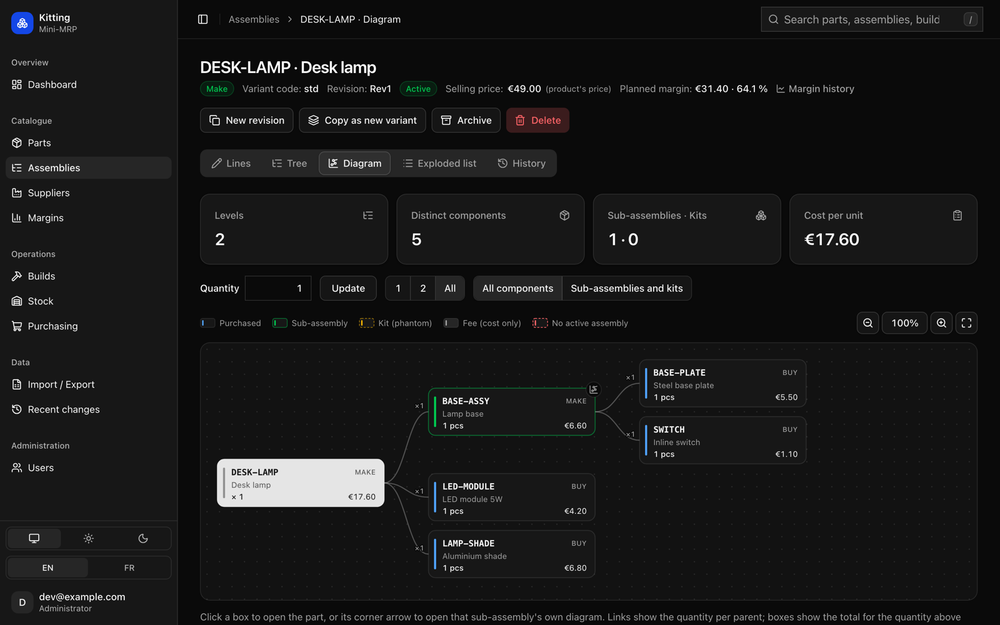

# Kitting

Kitting is a small open-source MRP for hardware makers. It keeps track of parts, assemblies, stock, purchase
orders and builds, down to the serial numbers inside each finished product. It's meant for workshops of a few
people who have outgrown spreadsheets but don't need an ERP.

It runs on Cloudflare: a Worker, a D1 database, and Cloudflare Access for sign-in. There is no server to
maintain, and a small workshop fits in the free plans.



## Features

- Parts you buy, make or sell as kits, with units, standard costs, selling prices and photos.
- Suppliers, with several offers per part (price, MOQ, pack size, lead time) and a history of every price.
- Assemblies (bills of materials) with variants and revisions, cost roll-up, a structure diagram and
  where-used.
- Stock kept as a ledger of movements, with adjustments, inventory counts and stock valuation.
- Builds with a pick list and serial traceability: what went into serial #0042, and which build used a given
  component.
- Purchasing: shortages for the planned builds, draft purchase orders per supplier, partial receipts.
- Planned and actual margins, and how they changed over time.
- A history of every change, most of which can be undone.
- Four roles (viewer, operator, planner, administrator). Costs can be hidden from the shop floor.
- CSV import and export that works with French and English Excel files, and a full JSON backup.
- An optional MCP server, so Claude or another AI assistant can work with your data, within your permissions.
- English and French, light and dark themes, usable on a tablet in the workshop.

Kitting doesn't do quotes, invoicing, accounting, multiple warehouses, barcode scanning or capacity planning.

## Try it locally

You need Node.js 20 or later.

```bash
npm ci
cp wrangler.example.jsonc wrangler.jsonc
cp .dev.vars.example .dev.vars
npm run db:migrate:local
npm run dev
```

Then open http://localhost:8787. Locally you are signed in as the email in `.dev.vars`, without Access.

To get some data, open **Import / Export** and import the files in [`examples/demo/`](examples/demo/) in this
order: suppliers, parts, assemblies, stock. The demo is a fictional desk lamp: a base sub-assembly plus two
parts. [`examples/full/`](examples/full/) has a larger version with variants, kits and serial numbers.

## Deploy

You need a Cloudflare account with a domain on it. The short version:

1. Create a D1 database. Optionally, create an R2 bucket for product photos and a KV namespace for the MCP
   server.
2. Put Cloudflare Access in front of the hostname you'll use.
3. Copy `wrangler.example.jsonc` to `wrangler.jsonc` and fill in the database ID, the hostname and the settings
   below.
4. Run `npm run deploy`. It applies the database migrations and deploys the Worker. Run it again to update.

You can also deploy from GitHub Actions: the manual Deploy workflow builds `wrangler.jsonc` from repository
variables, so nothing about your account ends up in git. [docs/deploy.md](docs/deploy.md) covers both, step by
step, along with the Access setup.

To run Kitting without copying its code (for example from your company's private repository), pin a release: a
Terraform module in [`infra/terraform`](infra/terraform) creates the database, the Access application and the
other Cloudflare resources, and a script deploys the release bundle with your settings. Upgrading is changing a
version number. See "Install with Terraform and a release" in [docs/deploy.md](docs/deploy.md).

| Setting | Example | |
| --- | --- | --- |
| `TEAM_DOMAIN` | `acme.cloudflareaccess.com` | Your Cloudflare Zero Trust team domain. |
| `ACCESS_AUD` | `4f1c…9a` | The audience tag of your Access application. |
| `ADMIN_EMAILS` | `ops@example.com,boss@example.com` | These people are always administrators. |
| `DEFAULT_LOCALE` | `fr` | `en` or `fr`. Each user can switch. |
| `CURRENCY` | `EUR` | Used to display amounts. |

In production, keep `ENVIRONMENT` set to `production` and `DEV_AUTH_EMAIL` empty.

## Security

Cloudflare Access handles sign-in, with Google, one-time codes by email or any provider Access supports. The
Worker checks the Access token again on every request and refuses anything without a valid one, so a
mistake in the Access policy doesn't expose the app. The `workers.dev` and preview URLs are turned off.

Permissions are checked on the server, not just hidden in the page, and every change records who made it.
The pages load no third-party scripts and are served with a strict Content Security Policy.

## Documentation

- [Deploying](docs/deploy.md): setup step by step, GitHub Actions, Cloudflare Access.
- [Administration](docs/administration.md): roles, change history and undo, backups.
- [AI assistants](docs/mcp.md): the MCP server and the Claude plugin.
- [CSV formats](docs/csv.md): the columns of each import.
- [Roadmap](docs/plan.md) and [design decisions](docs/decisions.md).

## Development

The app is server-rendered HTML (Hono JSX and a little htmx), styled with Tailwind CSS and the shadcn/ui design
tokens. Data lives in D1 (SQLite). Amounts are stored in integer cents and quantities in thousandths, so there
are no floating-point rounding errors.

| Command | |
| --- | --- |
| `npm run dev` | Local server on http://localhost:8787. |
| `npm run check` | Typecheck, lint and tests. Run it before committing. |
| `npm test` | Tests, run in the Workers runtime against a local D1 database. |
| `npm run db:generate` | Create a migration after changing `src/db/schema.ts`. |
| `npm run format` | Format the code with Biome. |

[CLAUDE.md](CLAUDE.md) describes the project's conventions, for people and coding agents alike.

## License

[MIT](LICENSE)
